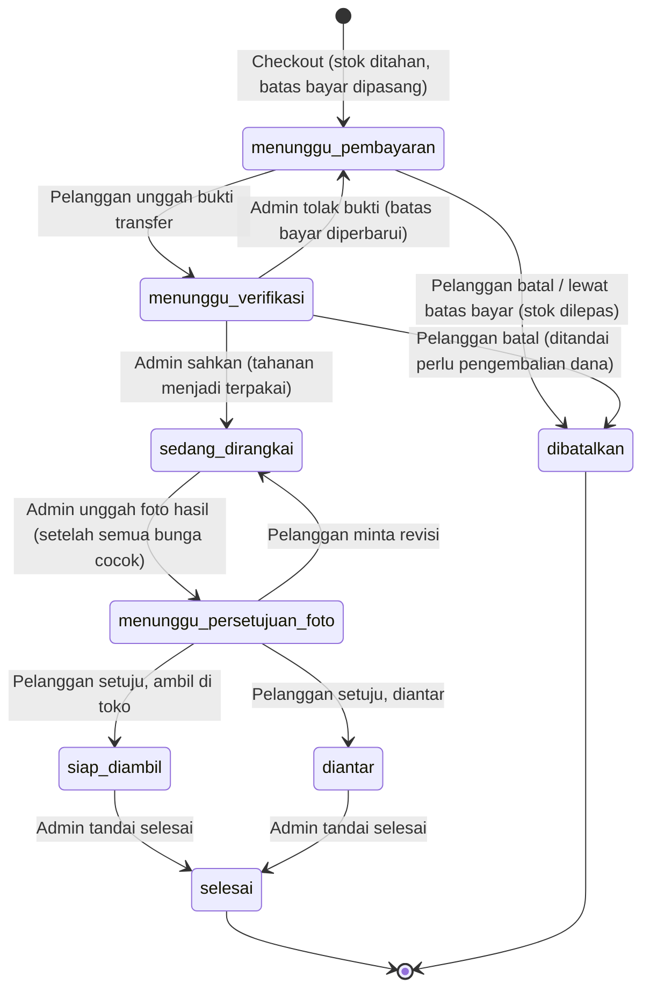

# Alur Kerja FlowerBloom

Dokumen ini adalah acuan tunggal tentang **siapa boleh melakukan apa, kapan, dan apa akibatnya** di backend. Setiap aturan di
sini ditegakkan oleh kode dan diuji (lihat `tests/`), bukan sekadar anjuran. Kode aturan bisnis (AB-xx) dan fitur (F-xx)
mengacu ke dokumen fitur v1.0; keputusan yang belum ada di dokumen tim dicatat di [keputusan-desain.md](keputusan-desain.md).

## 1. Prinsip

1. **Warna selalu punya nama.** Setiap objek warna di API membawa `nama_warna` dan `kode_hex` sekaligus (F-AK-01). Sumber
   tunggalnya tabel `warna`; stok, katalog, komposisi pesanan, dan label foto hanya merujuknya.
2. **Status tidak hanya warna.** Setiap status membawa `label`, `ikon`, dan `keterangan` (F-AK-02).
3. **Perubahan warna harus disetujui pelanggan.** Bunga pengganti berbeda warna tidak dapat disetujui tanpa konfirmasi eksplisit (AB-07).
4. **Satu pintu untuk status.** Status pesanan hanya berubah lewat `services/alur_pesanan.pindah_status` dengan baris pesanan terkunci.
5. **Server yang menghitung.** Harga, ongkos, dan total selalu dihitung di server; angka dari klien diabaikan.

## 2. Peran

| Peran | Bisa | Tidak bisa |
|---|---|---|
| Tamu | Melihat katalog, opsi rangkai sendiri, info toko; `pratinjau` harga | Membuat pesanan |
| Pelanggan | Semua milik tamu, checkout, bayar, batal, tanggapi foto, komplain, ubah profil/aksesibilitas; **hanya pesanan miliknya** (pesanan orang lain dijawab 404) | Membuka rute `/admin/*` |
| Admin | Semua rute `/admin/*`: stok, pindai, katalog, verifikasi, merangkai, foto hasil, laporan, pengaturan, akun | Checkout (admin bukan pelanggan) |

Pendaftaran publik **selalu** menghasilkan pelanggan; peran tidak pernah dibaca dari input. Admin pertama dibuat oleh
`python -m scripts.seed`, admin berikutnya oleh admin lain (`POST /admin/pengguna`).

## 3. Status pesanan



Tujuh tahap pada proposal ditambah **`dibatalkan`** (dibutuhkan AB-02 dan F-PL-15). `selesai` dan `dibatalkan` bersifat akhir.

### Tabel transisi

| Dari → Ke | Pemicu (endpoint) | Aktor | Syarat | Efek samping |
|---|---|---|---|---|
| (baru) → menunggu_pembayaran | `POST /pesanan` | Pelanggan | Tanggal ≥ H-1 (AB-04); slot valid; stok cukup; alamat bila diantar | Pesanan + rincian dibuat; **stok ditahan**; `batas_bayar` = sekarang + `batas_bayar_menit` |
| menunggu_pembayaran → menunggu_verifikasi | `POST /pesanan/{id}/pembayaran` | Pelanggan (pemilik) | Belum lewat `batas_bayar`; berkas gambar valid | Baris `pembayaran` status `menunggu` |
| menunggu_pembayaran → dibatalkan | `POST /pesanan/{id}/batal` atau penjadwal | Pelanggan / sistem | — | Stok dilepas |
| menunggu_verifikasi → sedang_dirangkai | `POST /admin/pesanan/{id}/pembayaran/{idb}/sahkan` | Admin | Pembayaran berstatus `menunggu` | Pembayaran `sah`; tahanan menjadi **terpakai** |
| menunggu_verifikasi → menunggu_pembayaran | `.../tolak` (wajib `catatan`) | Admin | Sama | Pembayaran `ditolak` + alasan; `batas_bayar` diperbarui; stok tetap ditahan |
| menunggu_verifikasi → dibatalkan | `POST /pesanan/{id}/batal` | Pelanggan | — | Stok dilepas; bukti ditolak; `perlu_pengembalian_dana = true` |
| sedang_dirangkai → menunggu_persetujuan_foto | `POST /admin/pesanan/{id}/foto-hasil` | Admin | **Semua bunga sudah cocok** (AB-05) | Warna foto dibaca → `label_warna`; ringkasan bunga pengganti dibekukan |
| menunggu_persetujuan_foto → siap_diambil / diantar | `POST /pesanan/{id}/persetujuan-foto` `setuju` | Pelanggan | Foto terbaru `menunggu`; konfirmasi pengganti bila wajib (AB-07) | Cabang menurut `cara_serah_terima` |
| menunggu_persetujuan_foto → sedang_dirangkai | idem, `revisi` (+`catatan_revisi`) | Pelanggan | Catatan minimal 3 huruf | `jumlah_revisi` +1; foto `revisi` |
| siap_diambil / diantar → selesai | `POST /admin/pesanan/{id}/selesai` | Admin | — | `diselesaikan_pada` diisi (mulai hitungan batas komplain) |

Transisi di luar tabel ini ditolak dengan `409 transisi_status_tidak_sah` dan **tidak meninggalkan jejak** apa pun.
Setiap transisi yang berhasil tercatat di `riwayat_status_pesanan` (pelaku, waktu, catatan); pelaku kosong berarti sistem.

**Pembatalan (AB-08).** Hanya di `menunggu_pembayaran` dan `menunggu_verifikasi`. Begitu pembayaran sah, pesanan langsung
`sedang_dirangkai`, jadi dari titik itu tidak dapat dibatalkan.

**Revisi (AB-06).** Boleh berkali-kali. Revisi melebihi jatah gratis (`jumlah_revisi_gratis`) menandai `revisi_berbayar` di
tampilan admin; **tidak ada penagihan otomatis** (menunggu keputusan tim).

## 4. Siklus stok

`stok` menyimpan satu baris per pasangan (jenis, warna), dengan dua angka. Kolom `jumlah_tersedia` sudah dikurangi yang ditahan.

```
             checkout                      pembayaran sah
tersedia ──────────────► ditahan ─────────────────────────► (terpakai)
    ▲                       │
    └───────────────────────┘
      batal / kedaluwarsa
```

| Peristiwa | Perubahan | Catatan mutasi |
|---|---|---|
| Stok masuk (pindai / manual) | `tersedia` +n; harga terbaru menimpa harga lama | `masuk_pindai` / `masuk_manual` |
| Checkout | `tersedia` −n, `ditahan` +n | `tahan` |
| Batal / kedaluwarsa | `ditahan` −n, `tersedia` +n | `lepas` |
| Pembayaran sah | `ditahan` −n | `pakai` |
| Bunga pengganti | `tersedia` −n pada bunga pengganti | `pakai` |
| Koreksi admin | `tersedia` = nilai baru | `koreksi` (selisih bertanda) |

* **Atomik.** Menahan stok memakai `UPDATE ... WHERE jumlah_tersedia >= n`; bila kalah berebut, seluruh pesanan gagal utuh
  (`409 stok_tidak_cukup` beserta rincian bunga yang kurang) dan tidak ada stok yang tertahan setengah jalan (F-NF-05).
  CHECK constraint (`>= 0`) menjadi pagar terakhir di basis data.
* **Aturan urutan penguncian (wajib dipatuhi kode baru agar tidak deadlock di MySQL):**
  1. Kunci baris **pesanan** lebih dulu (`alur_pesanan.kunci_pesanan` = `SELECT ... FOR UPDATE`).
  2. Lalu baris **stok**, selalu berurutan menurut `id_stok` naik.
  3. Kunci exclusive stok diambil lewat `UPDATE` **sebelum** menyisipkan baris apa pun yang mereferensikan stok
     (`komposisi_pesanan`, `mutasi_stok`). Bila terbalik, cek foreign key mengambil kunci *shared* lebih dulu dan dua transaksi yang
     menaikkannya ke *exclusive* saling menunggu (deadlock 1213, terbukti di MySQL; lihat `keputusan-desain.md` bagian D).
* **Buku mutasi** `mutasi_stok` mencatat semua perubahan; dari sana angka "jumlah masuk" (F-AD-13) dihitung.
* **Bunga asal yang diganti tidak dikembalikan otomatis** (bunga habis/rusak). Bila perlu, admin melakukan koreksi stok.

### Kedaluwarsa (AB-02)

Penjadwal (tiap `PENJADWAL_INTERVAL_DETIK`, bawaan 60 detik) membatalkan pesanan `menunggu_pembayaran` yang lewat `batas_bayar`
dan melepas stoknya. Ia aman dijalankan dari banyak proses (baris dikunci dan diperiksa ulang) dan **tidak menyentuh pesanan
`menunggu_verifikasi`**, supaya kelambatan admin tidak membatalkan pesanan yang sudah dibayar. Bila pelanggan mengunggah
bukti sesudah batas lewat, pesanan dibatalkan saat itu juga dan permintaan dijawab `409 batas_bayar_lewat`.

## 5. Pindai stok masuk (F-AD-11)

```mermaid
sequenceDiagram
    actor A as Admin
    participant API
    participant AI as Modul AI
    participant DB
    A->>API: POST /admin/stok/pindai (foto satu jenis bunga)
    API->>AI: warna dominan (k-means CIELAB) + nama warna terdekat
    AI-->>API: warna terdekat (jenis tidak ditebak: AI_MODE=nonaktif)
    API->>DB: simpan foto (privat) + riwayat_pindai (belum tertaut stok)
    API-->>A: warna (nama+hex), jenis_otomatis=false, peringatan
    Note over A: Admin memilih jenis dan memeriksa warna; bila keliru, mengoreksi lewat pilihan manual (AB-11)
    A->>API: POST /admin/stok/simpan-pindai (jenis & warna akhir, jumlah, harga)
    API->>DB: stok bertambah, mutasi dicatat, riwayat ditautkan + penanda dikoreksi
    API-->>A: stok terbaru (langsung tampil di katalog & Rangkai Sendiri)
```

* Proyek berjalan **tanpa model pengenal jenis** (keputusan B.19): admin memilih jenis, warna dibaca otomatis. `dikoreksi` hanya
  menilai warna, karena jenis memang dipilih admin.
* Bila kelak ada klasifikator (lihat `kontrak-model-ai.md`): keyakinan di bawah `AMBANG_KEYAKINAN` (bawaan 0,60) atau kelas yang
  belum ada di `jenis_bunga` → `dikenali=false`, dan admin memilih jenis manual.
* Input tanpa foto tetap tersedia: `POST /admin/stok/manual` (F-AD-12).
* `GET /admin/riwayat-pindai/ringkasan` menghitung akurasi warna (dan jenis, hanya atas pindai yang jenisnya ditebak otomatis) di
  pemakaian nyata dari pindai yang sudah disimpan.

## 6. Mode Merangkai, bunga pengganti, foto hasil

```mermaid
sequenceDiagram
    actor A as Admin
    actor P as Pelanggan
    participant API
    Note over A,API: Status: sedang_dirangkai
    loop tiap bunga diambil
        A->>API: POST .../merangkai/pindai (foto, jumlah tangkai, jenis pilihan admin opsional)
        API-->>A: cocok? (jenis sama + warna dalam toleransi) + progres
        Note over A,API: tanpa jenis pilihan: jenis ditentukan dari warna; bila warnanya cocok untuk beberapa jenis,<br/>id_komposisi_kandidat terisi dan admin memilih jenis lalu memindai lagi
    end
    opt bunga habis / rusak
        A->>API: POST .../merangkai/pengganti (asal, pengganti, jumlah, alasan)
    end
    opt pemindaian meleset
        A->>API: POST .../merangkai/tandai-cocok
    end
    A->>API: POST .../foto-hasil (aktif setelah semua baris cocok)
    API-->>P: menunggu_persetujuan_foto: foto + nama warna terbaca + bunga pengganti
    alt Setuju
        P->>API: persetujuan-foto {keputusan: setuju, setuju_pengganti}
        Note over API: siap_diambil atau diantar
    else Revisi
        P->>API: persetujuan-foto {keputusan: revisi, catatan_revisi}
        Note over API: kembali ke sedang_dirangkai
    end
```

**Aturan pencocokan.** Jenis harus sama persis. Warna dicocokkan dengan **warna terukur** (bukan nama terdekat) terhadap warna stok
pada ruang CIELAB; dianggap cocok bila jaraknya ≤ `AMBANG_KECOCOKAN_WARNA` (bawaan 20). Alasannya: hasil k-means dibulatkan ke nama
terdekat sehingga bunga di perbatasan dua nama bisa "meleset satu nama". Bila tetap meleset, admin memakai *Tandai cocok* (ditandai `ditandai_manual`).

**Bunga pengganti.** Mengurangi jumlah baris asal, menambah baris `is_pengganti` yang menunjuk baris asal, mengambil stok pengganti dari
`tersedia`, dan langsung dihitung cocok. Total harga tidak berubah. Ringkasannya dibekukan pada foto saat diunggah
(`dari`, `menjadi`, `jumlah`, `alasan`, `warna_berbeda`) sehingga tetap utuh sebagai bukti.

**Persetujuan pengganti (AB-07).** Menurut `kebijakan_pengganti`: `hanya_warna_berbeda` (bawaan) atau `semua_pengganti`. Bila wajib
dan `setuju_pengganti` tidak `true`, jawabannya `409 perlu_konfirmasi_pengganti` beserta rincian penggantian.

## 7. Komplain (AB-09)

Boleh diajukan pada pesanan `siap_diambil`, `diantar`, atau `selesai`, paling lambat `batas_komplain_jam` (bawaan 24) sejak
diterima (`diselesaikan_pada`, atau waktu masuk status bila belum ditandai selesai). Foto opsional. Admin menanggapi lewat `PATCH /admin/komplain/{id}`.

## 8. Berkas dan kerahasiaan (F-NF-07)

| Area | Isi | Akses |
|---|---|---|
| `publik/` | Foto produk katalog | `GET /media/...` (statis) |
| `privat/` | Bukti transfer, foto pindai, foto hasil, foto komplain | Hanya lewat tautan bertanda tangan `GET /api/v1/berkas/{token}` |

Tautan dibuat **setelah** otorisasi lolos (pemilik pesanan atau admin) dan berlaku `TAUTAN_BERKAS_BERLAKU_MENIT` (bawaan 10 menit),
sehingga tag `` (yang tidak dapat mengirim header `Authorization`) tetap bisa menampilkannya. Semua unggahan divalidasi sebagai
JPEG/PNG/WEBP, diputar sesuai EXIF, lalu disimpan ulang sebagai JPEG ≤ 1600 px tanpa metadata.

## 9. Format galat

Semua galat berbentuk `{ "kode": "...", "pesan": "...", "rincian": ... }`. Frontend bercabang pada `kode` (stabil), menampilkan `pesan`.

| HTTP | Contoh `kode` |
|---|---|
| 401 | `tidak_terautentikasi`, `kredensial_salah` |
| 403 | `dilarang`, `akun_nonaktif` |
| 404 | `tidak_ditemukan` (juga untuk pesanan milik orang lain) |
| 409 | `stok_tidak_cukup`, `transisi_status_tidak_sah`, `tidak_bisa_dibatalkan`, `batas_bayar_lewat`, `perlu_konfirmasi_pengganti`, `belum_semua_cocok`, `komplain_lewat_batas` |
| 422 | `validasi_gagal` (rincian per bidang), `tanggal_terlalu_dekat`, `slot_tidak_valid`, `tangkai_kurang`, `bukan_gambar` |
