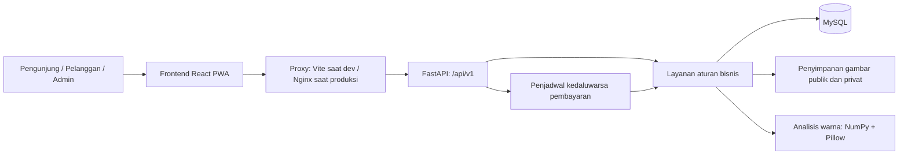
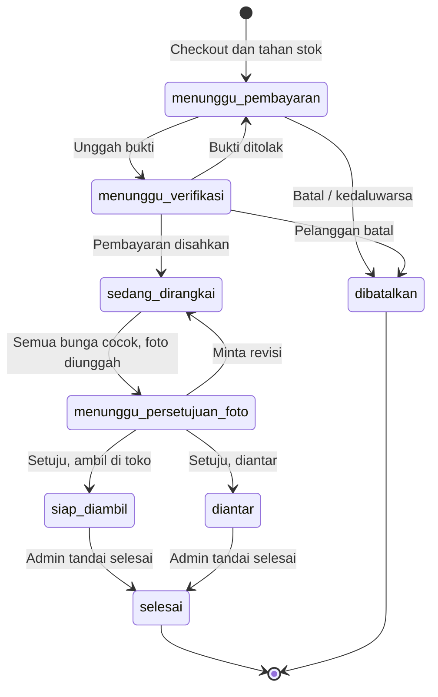

# Konteks Keseluruhan Proyek FlowerBloom

Tanggal peninjauan: **26 Oktober 2026**. Acuan kode: commit **`4585051`** dan berkas kerja saat peninjauan.

**Pembaruan implementasi 30 Oktober 2026:** lihat [perbaikan temuan](perbaikan-temuan.md) untuk perubahan checkout idempoten, pencatatan dana parsial, persetujuan pengganti, proteksi konkurensi, dan konfigurasi produksi.

Dokumen ini menjadi pintu masuk untuk memahami tujuan produk, implementasi yang sudah ada, alur bisnis, dan batasannya sebelum melanjutkan pengembangan. Sumbernya adalah kode, konfigurasi, dokumentasi repositori, dan pemeriksaan otomatis. Kode menjadi acuan apabila catatan lama berbeda dengan implementasi.

## 1. Identitas dan tujuan produk

**FlowerBloom** adalah toko bunga daring untuk Capstone S1 Sistem Informasi UNESA, dengan topik *Vision Disability*. Fokusnya membantu pelanggan dengan defisiensi penglihatan warna memilih dan memesan rangkaian bunga dengan informasi yang dapat dipahami tanpa mengandalkan warna visual saja.

Pembeda utama produk:

- Warna bunga disertai nama, kode heksadesimal, dan makna bila tersedia.
- Informasi produk dan rangkaian dapat didengarkan melalui tombol suara.
- Foto dapat ditampilkan dengan penajaman untuk protan, deutan, dan tritan.
- Admin mencocokkan bunga dengan komposisi pesanan saat merangkai.
- Pelanggan meninjau foto hasil beserta label warna dan bunga pengganti sebelum rangkaian diserahkan.

Secara implementasi, proyek sudah memiliki alur pelanggan dan operasional admin yang saling terhubung. Pekerjaan berikutnya perlu mempertahankan alur yang sudah ada dan menguji bagian yang belum tervalidasi di kondisi nyata. Persentase penyelesaian tidak ditetapkan karena penerimaan akhir tetap bergantung pada kebutuhan tim, pembimbing, dan pengguna toko.

## 2. Peran dan fitur yang sudah tersedia

| Peran | Kemampuan |
| --- | --- |
| Pengunjung | Melihat beranda, katalog, detail produk, informasi toko; mencoba Rangkai Sendiri, keranjang, dan pratinjau harga. |
| Pelanggan | Daftar/masuk, checkout, unggah bukti transfer, pantau pesanan, batal sebelum dirangkai, setujui/revisi foto, komplain, profil, ganti sandi, keluar dari semua perangkat, favorit, alamat, dan preferensi aksesibilitas. |
| Admin | Dasbor, verifikasi pembayaran, pesanan, Mode Merangkai, foto hasil, komplain, stok manual/pindai, riwayat pindai, katalog, laporan/CSV, pengaturan toko, dan akun admin. |

Pendaftaran publik selalu membuat akun pelanggan. Admin awal dibuat melalui seed; admin berikutnya dibuat oleh admin yang sudah memiliki akses. Pembatasan peran dan kepemilikan data ditegakkan oleh backend.

## 3. Arsitektur dan teknologi



| Bagian | Implementasi |
| --- | --- |
| Frontend | React 19, TypeScript strict, Vite 8, Tailwind CSS 4, React Router dengan pemuatan halaman terpisah. |
| Data dan formulir frontend | TanStack Query dan `openapi-fetch`; state React dan validasi formulir manual. |
| Backend | Python, FastAPI, Pydantic, SQLAlchemy, Alembic. |
| Basis data | MySQL 8.4 untuk deployment dan pengujian transaksi penuh; SQLite untuk pengembangan/tes cepat. |
| Pengolahan gambar | Pillow dan NumPy; k-means dalam ruang CIELAB untuk warna. |
| Autentikasi | JWT Bearer, hash sandi bcrypt dengan pra-hash SHA-256, versi sesi untuk pencabutan token. |
| PWA | `vite-plugin-pwa` dan Workbox: pemasangan, cache data publik, indikator offline, pembaruan versi. |
| Deployment | Docker Compose: `db`, `api`, `web`; Nginx menyajikan frontend dan meneruskan `/api` serta `/media`. |
| Pemeriksaan kualitas | Pytest, Ruff, Vitest/Testing Library, TypeScript, oxlint, Prettier, GitHub Actions. |

Versi dependensi yang dipakai proyek mengikuti lockfile dan requirements terkunci. Frontend menetapkan `pnpm@11.0.8`; CI dan image frontend memakai Node 24. CI backend menguji Python 3.13 dan 3.14.

## 4. Peta kode dan dokumen

| Lokasi | Tanggung jawab |
| --- | --- |
| [`../README.md`](../README.md) | Pengenalan, menjalankan aplikasi, CI/CD. |
| [`../frontend/src/app/rute.tsx`](../frontend/src/app/rute.tsx) | Seluruh rute pelanggan/admin dan penjaga akses UI. |
| [`../frontend/src/api/`](../frontend/src/api/) | Klien HTTP bertipe, hook data pelanggan/admin, tipe hasil OpenAPI. |
| [`../frontend/src/fitur/`](../frontend/src/fitur/) | Halaman per domain: katalog, rangkai, keranjang, pesanan, akun, admin. |
| [`../frontend/src/auth/`](../frontend/src/auth/) | Sesi dan penjaga rute. |
| [`../frontend/src/aksesibilitas/`](../frontend/src/aksesibilitas/) | Preferensi, filter foto, suara, sinkronisasi akun. |
| [`../frontend/src/komponen/`](../frontend/src/komponen/) | Komponen antarmuka bersama. |
| [`../frontend/vite.config.ts`](../frontend/vite.config.ts) | Proxy pengembangan, manifest, kebijakan cache PWA, konfigurasi tes. |
| [`../backend/app/main.py`](../backend/app/main.py) | Aplikasi API, pemasangan router, CORS, media publik, penjadwal. |
| [`../backend/app/routers/`](../backend/app/routers/) | Lapisan HTTP, dependensi akses, pemanggilan layanan, commit transaksi. |
| [`../backend/app/services/`](../backend/app/services/) | Aturan bisnis; pusat perubahan pesanan dan stok. |
| [`../backend/app/models/`](../backend/app/models/) | Model tabel dan relasi. |
| [`../backend/app/schemas/`](../backend/app/schemas/) | Validasi dan kontrak permintaan/respons. |
| [`../backend/app/ai/`](../backend/app/ai/) | Analisis warna, deskripsi templat, antarmuka klasifikator jenis. |
| [`../backend/app/core/`](../backend/app/core/) | Keamanan, penyimpanan, tautan privat, galat, tipe, waktu. |
| [`../backend/migrations/`](../backend/migrations/) | Riwayat skema Alembic: `0001`, `0002`, dan `0003`. |
| [`../backend/scripts/seed.py`](../backend/scripts/seed.py) | Data acuan, admin awal, data demonstrasi opsional. |
| [`../backend/tests/`](../backend/tests/) | Tes aturan bisnis, API, keamanan, gambar, konkurensi. |
| [`../.github/workflows/`](../.github/workflows/) | CI, keamanan, penerbitan image/rilis. |

Dokumen pendamping yang tetap menjadi rujukan:

- [Alur kerja backend](../backend/docs/alur-kerja.md): transisi status dan akibatnya.
- [Pemetaan fitur](../backend/docs/pemetaan-fitur.md): kode F-PL/F-AD/F-AI/F-AK/F-NF dan AB ke modul/API.
- [Keputusan desain](../backend/docs/keputusan-desain.md): asumsi dan pertanyaan tim.
- [Kontrak model AI](../backend/docs/kontrak-model-ai.md): syarat jika klasifikator jenis kelak dipasang.
- [Keputusan aksesibilitas](aksesibilitas.md): desain warna, penajaman, dan preferensi.
- [Kontrak OpenAPI](../backend/docs/openapi.json): sumber tipe API frontend.
- [Panduan kontribusi](../CONTRIBUTING.md): aturan perubahan kode dan migrasi.

## 5. Alur bisnis utama

### 5.1 Pemilihan dan checkout

1. Pelanggan memilih paket katalog atau merakit komposisi dari stok yang tersedia.
2. Keranjang disimpan di perangkat. Backend memvalidasi ulang harga dan stok melalui `POST /api/v1/pesanan/pratinjau`.
3. Checkout memerlukan akun pelanggan, tanggal, slot, penerima, dan cara serah terima. Alamat diperlukan untuk pengantaran.
4. Backend menghitung harga, membuat detail/komposisi pesanan, menahan stok, dan memasang batas pembayaran dalam satu transaksi.

Harga paket mengikuti harga produk. Harga Rangkai Sendiri adalah jumlah harga tangkai ditambah jasa merangkai; ongkos antar ditambahkan sesuai cara serah terima. Harga pesanan dibekukan saat checkout.

### 5.2 Status pesanan



Ada **8 nilai status**, termasuk dua cabang serah terima dan `dibatalkan`. Semua perubahan status melewati [`alur_pesanan.py`](../backend/app/services/alur_pesanan.py) dan dicatat dalam riwayat.

Aturan yang memengaruhi perilaku aplikasi:

- Pembatalan pelanggan hanya tersedia pada dua status pertama.
- Bukti ditolak mengembalikan pesanan ke menunggu pembayaran dengan batas baru; stok tetap ditahan.
- Pesanan yang menunggu verifikasi tidak dibatalkan oleh penjadwal kedaluwarsa pembayaran.
- Pembayaran sah langsung memulai status sedang dirangkai.
- Persetujuan foto langsung menentukan siap diambil atau diantar; admin kemudian menandai selesai.
- Pembatalan saat menunggu verifikasi menyalakan penanda pengembalian dana. Transfer balik dilakukan manual, lalu admin dapat menandainya selesai.

### 5.3 Stok

Satu baris stok mewakili pasangan **jenis bunga + warna**. `jumlah_tersedia` sudah dikurangi tangkai yang ditahan.

| Kejadian | Tersedia | Ditahan |
| --- | --- | --- |
| Stok masuk | Bertambah | Tetap |
| Checkout | Berkurang | Bertambah |
| Batal / lewat batas bayar | Bertambah | Berkurang |
| Pembayaran sah | Tetap | Berkurang; resmi terpakai |
| Pemakaian bunga pengganti | Berkurang | Tetap |

Perubahan dicatat di `mutasi_stok`. Penahanan memakai pembaruan bersyarat agar stok tidak negatif ketika checkout bersamaan. Urutan penguncian dan penulisan di layanan stok/pesanan harus dipertahankan karena memengaruhi konkurensi MySQL. Input stok baru memperbarui harga per tangkai untuk pasangan tersebut.

### 5.4 Merangkai, foto, pengganti, komplain

- Mode Merangkai mencocokkan jenis dan warna terhadap sisa komposisi; tersedia jalur pindai dan tandai cocok manual.
- Foto hasil hanya boleh diunggah setelah seluruh tangkai yang diperlukan sudah cocok.
- Foto menghasilkan maksimal empat label warna beserta persentase dan menyimpan ringkasan bunga pengganti pada saat unggah.
- Pengganti berbeda warna memerlukan persetujuan eksplisit pelanggan. Kebijakan dapat diubah agar semua pengganti harus disetujui.
- Bunga pengganti tidak mengubah total pesanan dan tidak otomatis mengembalikan bunga asal ke stok.
- Revisi mengembalikan pesanan ke proses merangkai. Revisi tambahan dapat ditandai berbayar, tetapi belum ada penagihan otomatis.
- Satu komplain per pesanan dapat diajukan sejak status siap diambil/diantar/selesai. Batas waktu dihitung dari waktu selesai, atau waktu masuk status terkait bila belum selesai; ini belum merupakan bukti waktu penerimaan fisik. Foto komplain bersifat opsional di kode.

## 6. Pemrosesan warna dan status AI saat ini

**Konfigurasi bawaan adalah `AI_MODE=nonaktif`.** Artinya admin memilih jenis bunga, sementara analisis warna tetap berjalan otomatis. Kode saat ini menyediakan dua mode:

| Mode | Perilaku |
| --- | --- |
| `nonaktif` | Tanpa klasifikator jenis; admin memilih jenis. Pada Mode Merangkai, jenis juga dapat disimpulkan bila warna hanya cocok dengan satu jenis tersisa. |
| `tiruan` | Prediksi jenis buatan untuk mencoba alur pengembangan; tidak menunjukkan akurasi model dan ditolak pada lingkungan produksi. |

Belum ada mode model terlatih dalam konfigurasi. Antarmuka klasifikator dipertahankan untuk pengembangan berikutnya sesuai keputusan desain B.19.

Analisis warna di [`ai/warna.py`](../backend/app/ai/warna.py) mengecilkan gambar, memilih piksel dengan heuristik, melakukan k-means dalam CIELAB, lalu mencari nama warna acuan terdekat. Pencocokan Mode Merangkai memakai jarak warna terukur dengan toleransi bawaan 20.

Pemisahan kelopak masih menggunakan heuristik latar/daun, sehingga hasil dipengaruhi pencahayaan, latar, dan komposisi foto. Persentase label foto adalah proporsi piksel yang dianalisis, bukan persentase jumlah tangkai. Data awal berisi 102 jenis bunga dan 22 warna; nama, bentuk, serta maknanya masih memerlukan peninjauan tim.

Saran perpaduan warna **sudah tersedia** di [`frontend/src/lib/perpaduan.ts`](../frontend/src/lib/perpaduan.ts), memakai aturan netral, analog, pastel, dan kontras. Pratinjau Rangkai Sendiri berupa SVG susunan warna menyerupai buket, dengan maksimal 60 titik tampilan.

## 7. Integrasi frontend, API, dan penyimpanan

- API bisnis memakai prefiks `/api/v1`. Endpoint pemeriksaan hidup adalah `/kesehatan`.
- Kontrak backend tersimpan di `backend/docs/openapi.json`; generator menghasilkan `frontend/src/api/schema.d.ts`.
- `api/client.ts` memasang Bearer token, menyeragamkan galat, dan menghapus sesi saat respons 401. Hook pelanggan/admin mengelola kueri dan mutasi dengan TanStack Query.
- Sesi berada di `sessionStorage`, atau `localStorage` bila pengguna memilih ingat saya. Keranjang juga lokal; tidak ada tabel keranjang di backend.
- Notifikasi diturunkan dari status pesanan/komplain/dasbor. Pembaruan memakai polling; belum ada email atau push notification.
- Gambar publik dilayani lewat `/media`. Bukti transfer, foto hasil, komplain, dan pindai menggunakan area privat dengan tautan bertanda tangan berumur pendek.
- Backend memvalidasi ukuran/format gambar dan menyimpan ulang sebagai JPEG. Akses pesanan pelanggan lain ditolak tanpa mengungkap keberadaannya.
- JWT berlaku bawaan 8 jam tanpa refresh token. Ganti sandi dan keluar dari semua perangkat mencabut token lama lewat `versi_sesi`; akun nonaktif juga ditolak.

Kelompok API utama dapat dicari melalui router berikut:

| Domain | Awalan / tindakan | Router |
| --- | --- | --- |
| Akun | `/auth`, `/aksesibilitas/saya`, `/favorit`, `/alamat` | `auth.py`, `akun_pelanggan.py` |
| Referensi | `/warna`, `/jenis-bunga` | `referensi.py` |
| Katalog | `/produk`, `/rangkai/opsi`, `/toko/info`, `/admin/produk`, `/admin/pengaturan-toko` | `katalog.py` |
| Stok | `/admin/stok`, `/admin/riwayat-pindai` | `admin_stok.py` |
| Pesanan pelanggan | `/pesanan`, pembayaran, batal, persetujuan foto, komplain | `pesanan.py` |
| Operasional admin | `/admin/pesanan`, merangkai, foto, pembayaran, selesai, pengembalian dana, dasbor, laporan, komplain, pengguna | `admin_pesanan.py` |
| Berkas privat | `/berkas/{token}`; tidak ditampilkan dalam skema OpenAPI | `berkas.py` |

Awalan pada tabel mengikuti prefiks `/api/v1`.

## 8. Model data

Implementasi memiliki **19 tabel**, dikelompokkan sebagai berikut:

| Kelompok | Tabel |
| --- | --- |
| Akun | `pengguna`, `pengaturan_aksesibilitas`, `favorit`, `alamat` |
| Referensi bunga | `jenis_bunga`, `warna` |
| Persediaan | `stok`, `riwayat_pindai`, `mutasi_stok` |
| Katalog | `produk`, `komposisi_produk` |
| Transaksi | `pesanan`, `detail_pesanan`, `komposisi_pesanan`, `pembayaran`, `foto_konfirmasi`, `riwayat_status_pesanan` |
| Operasional | `pengaturan_toko`, `komplain` |

Hubungan inti: pelanggan memiliki pesanan → pesanan memiliki detail → detail memiliki komposisi yang merujuk stok → stok merujuk jenis bunga dan warna. Produk memiliki komposisi acuan; komposisi pesanan dibentuk saat checkout. Pembayaran, foto, dan riwayat status tersimpan per pesanan.

Migrasi `0002` menambahkan favorit, alamat, dan versi sesi. Waktu disimpan sebagai UTC; perhitungan hari bisnis memakai WIB. Nilai uang menggunakan desimal di backend/basis data.

Migrasi `0003` menambahkan kunci/hash checkout per pelanggan beserta indeks unik dan penanda dana diterima pada pembayaran. Pembayaran lama berstatus sah diisi otomatis sebagai dana diterima; bukti ditolak memerlukan pemeriksaan operasional.

## 9. Aksesibilitas dan PWA

Implementasi mencakup nama/kode warna, ikon dan teks status, label serta galat ARIA, fokus terlihat, dialog modal, reduced motion, tema gelap, kontras tinggi, ukuran teks, alternatif tabel untuk grafik, dan suara Web Speech API.

Jenis buta warna, penajaman, ukuran teks, kecepatan suara, dan tema disinkronkan ke akun pelanggan. `kontras_tinggi` dan `suara_aktif` hanya disimpan di perangkat.

Analisis warna foto terjadi otomatis setelah unggah; **pembacaan suara dimulai melalui tombol pengguna**. Ketersediaan suara Indonesia mengikuti dukungan peramban/perangkat. WCAG 2.2 AA adalah target desain; kelulusan tes komponen belum membuktikan seluruh aplikasi memenuhi target tersebut.

PWA menyimpan kerangka aplikasi, gambar publik, dan API publik yang diizinkan. Katalog yang pernah dibuka dapat tersedia saat offline; checkout, pembayaran, pemindaian, dan operasional admin tetap membutuhkan server. API akun/transaksi/admin tidak masuk kebijakan cache service worker.

## 10. Konfigurasi dan menjalankan proyek

Ada dua konteks `.env`: root untuk Docker Compose seluruh aplikasi, dan `backend/.env` untuk backend lokal. Contoh nilainya berada di `.env.example` masing-masing. Rahasia dan konfigurasi lokal tidak dimasukkan ke dokumentasi ini.

### Pengembangan lokal di Windows

Gunakan Python 3.13/3.14 dan Node 24 untuk menyamai lingkungan CI. Perintah berikut dijalankan dari root proyek; pembuatan environment, penyalinan konfigurasi, dan instalasi dilakukan bila belum tersedia.

```powershell
Set-Location backend
python -m venv .venv
.\.venv\Scripts\python.exe -m pip install --require-hashes -r requirements-dev.txt
if (-not (Test-Path .env)) { Copy-Item .env.example .env }
# Sesuaikan konfigurasi backend sebelum migrasi.
.\.venv\Scripts\python.exe -m alembic upgrade head
.\.venv\Scripts\python.exe -m scripts.seed --demo
.\.venv\Scripts\python.exe -m uvicorn app.main:app --reload
```

Terminal kedua, dari root proyek:

```powershell
Set-Location frontend
corepack enable
pnpm install --frozen-lockfile
pnpm dev
```

Frontend: `http://localhost:5173`. Backend: `http://127.0.0.1:8000`; dokumentasi API pengembangan tersedia di `/docs`. Vite meneruskan `/api` dan `/media` ke backend; target dapat diganti melalui `VITE_BACKEND_URL`.

Untuk percobaan cepat, contoh konfigurasi memakai SQLite. MySQL diperlukan untuk pengujian kunci baris dan konkurensi yang mewakili deployment. `--demo` hanya untuk pengembangan dan ditolak di produksi; seed tanpa opsi tersebut membuat data acuan dan admin awal.

### Docker dan deployment

Compose root menjalankan MySQL + API + web. Setelah menyalin contoh `.env` bila belum ada dan mengisi konfigurasi yang diperlukan:

```powershell
docker compose up -d --build
docker compose exec api python -m scripts.seed
```

Web tersedia bawaan di `http://localhost:8080`. Entrypoint backend menjalankan migrasi sebelum aplikasi. Data MySQL dan gambar dipersistenkan dalam volume terpisah. Compose root memakai lingkungan produksi sehingga tidak menerima seed demo. Konfigurasi TLS publik diperlukan untuk penggunaan fitur PWA/kamera di domain deployment.

Workflow CD membangun dan menerbitkan image ke GHCR; deployment ke server tetap memerlukan pengambilan image dan pembaruan container. Definisi workflow menunjukkan proses yang dirancang, bukan bukti bahwa deployment tertentu sudah berjalan.

## 11. Aturan penting saat melanjutkan pengembangan

1. Tempatkan aturan bisnis di `backend/app/services/`; router menangani HTTP dan commit. Layanan tidak melakukan commit sendiri.
2. Ubah status melalui `alur_pesanan.pindah_status`; ubah stok melalui layanan stok. Pertahankan transaksi dan urutan penguncian.
3. Perubahan skema memakai migrasi baru; jangan mengubah migrasi yang sudah digunakan tim.
4. Jika API berubah, ekspor ulang OpenAPI lalu buat ulang tipe frontend:

   ```powershell
   # Di backend
   .\.venv\Scripts\python.exe -m scripts.ekspor_openapi
   # Di frontend
   pnpm api:types
   ```

5. Pertahankan label warna, teks status, navigasi papan ketik, dan jalur manual ketika pemindaian kurang tepat.
6. Nilai pembayaran dan stok harus selalu divalidasi backend. Harga atau ketersediaan lokal hanya membantu tampilan.

Pengaturan bisnis bawaan berada di [`pengaturan_toko.py`](../backend/app/services/pengaturan_toko.py), dan dapat diubah lewat panel admin:

| Pengaturan | Bawaan |
| --- | --- |
| Batas bayar | 120 menit |
| Minimal jarak pemesanan | H-1; tanggal maksimal 90 hari ke depan |
| Minimal Rangkai Sendiri | 5 tangkai |
| Jasa merangkai / ongkos antar | Rp10.000 / Rp15.000 |
| Jatah revisi gratis | 1 kali |
| Batas tanggapan foto / komplain | 24 jam / 24 jam |
| Slot serah terima | 09:00–11:00, 11:00–13:00, 13:00–15:00, 15:00–17:00 |

Angka bawaan adalah asumsi pengembangan, bukan keputusan toko yang sudah divalidasi. Batas 90 hari merupakan konstanta layanan, sedangkan pengaturan lain pada tabel tersedia sebagai pengaturan toko.

## 12. Hasil pemeriksaan dan batas peninjauan

**Pembaruan 30 Oktober 2026:** pengujian lanjutan sudah mencakup MySQL, build Docker aktual, migrasi, alur browser utama, penjadwal, backup/restore, dan persistensi. Ada temuan prioritas tinggi di luar suite existing. Baca [laporan pengujian mendalam](laporan-pengujian.md); tabel berikut tetap merupakan catatan pemeriksaan awal.

Hasil pemeriksaan lokal tanggal **26 Oktober 2026** dengan dependensi yang sudah tersedia:

| Pemeriksaan | Hasil aktual |
| --- | --- |
| Pytest backend, SQLite terisolasi | **130 lulus, 2 dilewati**; dua tes memerlukan kunci baris MySQL. |
| Ruff backend | Lulus. |
| oxlint frontend | Lulus. |
| TypeScript aplikasi dan konfigurasi Node | Lulus; masing-masing diperiksa dengan `tsc --noEmit -p`. |
| Prettier frontend, `format:check` | Lulus. |
| Vitest frontend | **38 tes dalam 5 berkas lulus**. |
| Build Vite produksi dan service worker | Lulus; output diarahkan ke folder sementara. |
| OpenAPI dari aplikasi dibanding JSON tersimpan | Identik; **57 path dan 66 operasi** dalam kontrak. |

Runtime peninjauan: Python 3.14.0, Node 24.15.0, pnpm 11.0.8. Tes backend memakai basis data uji terisolasi; tidak menjalankan migrasi atau seed pada basis data aplikasi. Pemeriksaan frontend tidak menimpa `dist/` proyek. Jumlah tes pada README lama merupakan catatan versi sebelumnya.

Peninjauan ini belum mencakup tes MySQL, migrasi langsung, build/runtime image Docker, pengukuran coverage, audit kerentanan, uji browser/UAT di toko, audit aksesibilitas manual menyeluruh, akurasi foto nyata, atau pengujian deployment publik. Pengujian SQLite tidak menggantikan verifikasi transaksi MySQL. Status CI/CD remote tidak diperiksa.

## 13. Catatan untuk finalisasi

| Area | Keadaan saat ini / tindak lanjut yang relevan |
| --- | --- |
| Validasi warna | Tes memakai gambar sintetis; perlu foto asli toko dengan jenis, warna, latar, dan pencahayaan yang bervariasi. |
| Kesesuaian kebutuhan capstone | Keputusan berjalan tanpa model pengenal jenis sudah tercatat; perlu selaras dengan dokumen akademik dan persetujuan tim/pembimbing. |
| Kebijakan operasional | Biaya revisi tambahan, tindak lanjut foto yang tidak ditanggapi, kapasitas slot, dan mekanisme refund masih memerlukan keputusan operasional. Kode saat ini hanya menandai beberapa kondisi tersebut. |
| Integrasi pembayaran | Transfer dan verifikasi admin; pengembalian dana dilakukan manual. |
| Ketahanan permintaan | Belum ada kunci idempotensi checkout untuk mencegah pesanan ganda ketika permintaan yang sama dikirim ulang. |
| Notifikasi | Polling dan informasi dalam aplikasi; email/push belum tersedia. |
| Pengelolaan media | Belum ada pembersihan otomatis gambar lama. |
| Skala proses | Pembatas percobaan masuk tersimpan di memori proses; deployment beberapa worker perlu mempertimbangkan penyimpanan bersama. |
| Validasi UI | Tes frontend saat ini menguji fungsi/komponen; belum ditemukan suite E2E browser. UAT alur lengkap dan pengujian oleh pengguna sasaran tetap diperlukan. |

Perbedaan dokumentasi lama yang ditemukan saat peninjauan:

- `pemetaan-fitur.md` dan bagian batasan `keputusan-desain.md` masih menandai F-PL-06 belum ada; saran perpaduan sudah diimplementasikan di frontend.
- Frasa pembacaan label foto otomatis pada README perlu dibedakan dari pembacaan suara melalui tombol pengguna.
- Jumlah tes dan bukti MySQL bertanggal pada README/dokumen backend adalah catatan historis, bukan hasil peninjauan saat ini.
- Contoh `TAG=v1.0.0` pada dokumentasi deployment perlu diselaraskan dengan pola metadata CD `{{version}}`; tag versi image ditujukan berbentuk `1.0.0`. Pastikan tag benar-benar tersedia di registry sebelum dipakai.

Dokumen ini tidak mengubah keputusan produk atau perilaku aplikasi. Perbarui bagian terkait apabila alur, model data, konfigurasi, atau hasil validasi berubah.
